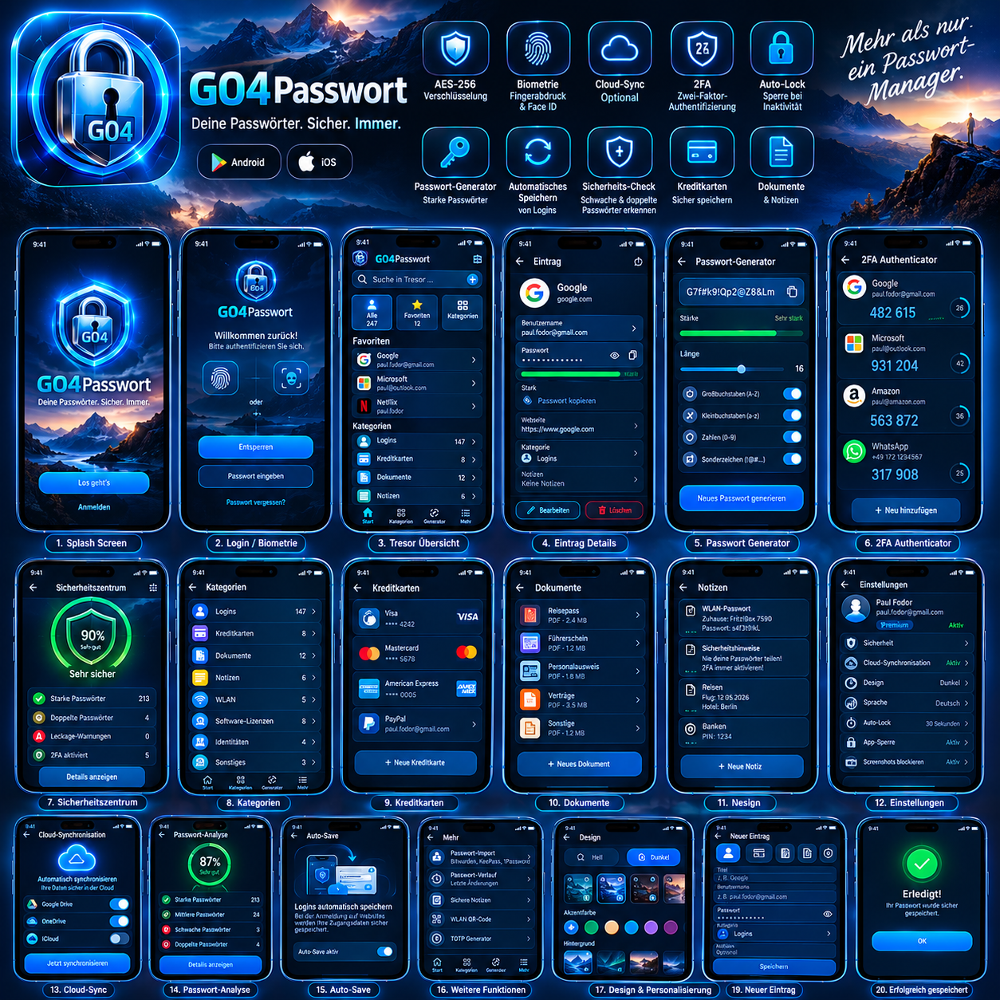
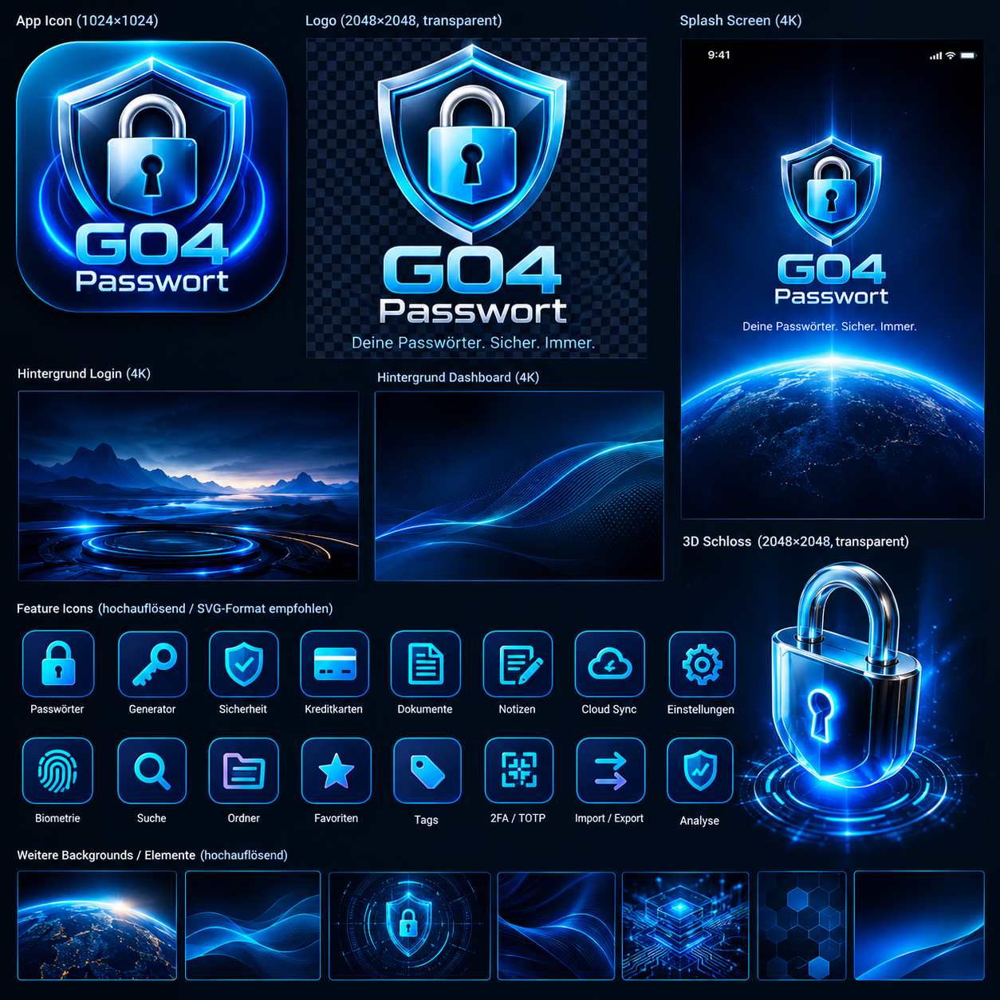

<p align="center">
  
</p>

<h1 align="center">G04Passwort</h1>

<p align="center">
  
  
  
  
  
</p>

---

**G04Passwort** ist ein Premium-Passwort-Tresor im futuristischen *Night-Glass*-Design: dunkle Nachtlandschaften, Glassmorphism, Neon-Blau und Cyan-Glow.
Die App verwaltet Zugangsdaten zu Websites und Portalen, aber auch zu **Geräten, HMIs/Steuerungen und Routern**, dazu Kreditkarten, Dokumente, sichere Notizen und 2FA-Codes. Alles wird **lokal und Ende-zu-Ende verschlüsselt** gespeichert (Zero-Knowledge).

## Inhalt

- [Features](#features)
- [Sicherheitsarchitektur](#sicherheitsarchitektur)
- [Screenshots](#screenshots)
- [Installation](#installation)
- [Projektstruktur](#projektstruktur)
- [Roadmap](#roadmap)
- [Lizenz](#lizenz)

## Features

| Bereich | Funktionen |
|---|---|
| 🔐 **Tresor** | Logins, Kreditkarten, Dokumente (mit verschlüsselten PDF-/Bild-Anhängen), sichere Notizen |
| 🗂️ **Organisation** | 12 Kategorien (inkl. WLAN, Lizenzen, Identitäten, Geräte, HMI, Router, Portale), Ordner, Tags, Favoriten |
| 🔎 **Suche** | Sofortige Volltextsuche über Titel, Benutzer, URLs, Host/IP, Tags und Notizen |
| ⚙️ **Generator** | Passwörter (4–64 Zeichen, Zeichenklassen, ähnliche Zeichen vermeiden), Passphrasen und PINs, gestützt auf `Random.secure()` |
| 📊 **Sicherheitszentrum** | Sicherheits-Score, Passwortanalyse (Entropie + Muster), Duplikat-Erkennung, alte Passwörter, 2FA-Abdeckung |
| 🔢 **2FA (TOTP)** | RFC 6238 Authenticator mit Countdown-Ringen, `otpauth://`-Links, SHA-1/256/512 |
| 👆 **Biometrie** | Fingerabdruck, Face ID, Windows Hello (`local_auth`) |
| ⏱️ **Auto-Lock** | Sperre bei Inaktivität und im Hintergrund; konfigurierbar (sofort … nie) |
| 📋 **Zwischenablage** | Automatisches Leeren kopierter Passwörter |
| 🛡️ **Screenshot-Schutz** | Android `FLAG_SECURE` und Privacy-Shield in der App-Übersicht auf allen Plattformen |
| 💾 **Backup** | Verschlüsseltes Backup (`.g04vault`), Wiederherstellung mit Zusammenführung |
| ⇄ **Import/Export** | CSV-Import aus Bitwarden, 1Password, KeePass, Chrome, Edge, Firefox und LastPass; CSV-Export |
| ☁️ **Cloud Sync** | Zero-Knowledge-Sync-Architektur (Google Drive, OneDrive, iCloud, WebDAV vorbereitet) |
| 🎨 **Design** | Material 3, Dark/Light, 6 Akzentfarben, 11 Hintergründe, Glassmorphism, Lottie-Animationen, responsiv mit Navigation Rail auf Tablet und Desktop |

### Handy, Tablet & Desktop

| Gerät | Layout |
|---|---|
| 📱 Handy (< 600 px) | Glas-Bottom-Navigation, eine Spalte |
| 📲 Tablet (600–1199 px) | Navigation Rail, 2 Spalten (Dashboard, Listen, Einstellungen) |
| 🖥️ Desktop (≥ 1200 px) | Ausgeklappte Seitenleiste mit „Neuer Eintrag“, bis zu 3 Spalten |

Tastaturkürzel (Web/Desktop): **Strg/⌘ + K** Suche · **Strg/⌘ + N** neuer Eintrag · **Strg/⌘ + G** Generator · **Strg/⌘ + L** Tresor sperren

**Web-App:** https://paulfv.github.io/G04Passwort/ – auf iPhone/Android über „Zum Home-Bildschirm“, am Desktop (Chrome/Edge) über „App installieren“ in der Adressleiste.

### Screens

Splash · Onboarding · Login/Biometrie · Master-Passwort · Dashboard (Tresor-Übersicht) · Passwortliste · Passwortdetails · Neuer Eintrag · Passwort-Generator · Sicherheitszentrum · Passwort-Analyse · 2FA Authenticator · Dokumente · Kreditkarten · Sichere Notizen · Kategorien · Suche · Einstellungen · Design & Personalisierung · Auto-Save · Profil · Backup · Cloud Sync · Passwort-Verlauf · Mehr · About

## Sicherheitsarchitektur

```
Master-Passwort ──Argon2id (19 MiB, t=2, p=1, 128-Bit-Salt)──► KEK (nie gespeichert)
KEK ──AES-256-GCM──► verschlüsselter Tresor-Schlüssel (Vault-Header)
Tresor-Schlüssel (zufällig, 256 Bit) ──AES-256-GCM + AAD──► jeder Eintrag / Ordner / Anhang
```

- **Zero-Knowledge:** Das Master-Passwort verlässt nie das Gerät. Ohne Passwort ist kein Zugriff möglich, auch nicht für den Entwickler.
- **Authentifizierte Verschlüsselung:** AES-256-GCM mit zufälliger 96-Bit-Nonce pro Datensatz. Die Associated Data (`item:<id>`) verhindert das Vertauschen von Datensätzen.
- **Datenbank ohne Klartext:** SQLite (Drift) speichert nur `id`, Zeitstempel und verschlüsselte Payloads.
- **Key-Derivation:** Argon2id (Hintergrund-Isolate) auf Android, iOS und Desktop; im Web PBKDF2-SHA256 mit 600 000 Iterationen über WebCrypto, damit die Oberfläche nicht einfriert. Die Parameter liegen im Header und lassen sich später erhöhen.
- **Brute-Force-Schutz:** Nach 5 Fehlversuchen greift eine exponentielle Sperre, die auch einen Neustart der App übersteht.
- **Schlüsselprüfung:** Ein veralteter Biometrie-Schlüssel (z. B. nach Neuinstallation) wird erkannt und verworfen.
- **Biometrie:** Der Tresor-Schlüssel liegt nach Aktivierung im Keychain/Keystore (`flutter_secure_storage`) und wird erst nach erfolgreichem `local_auth`-Prompt gelesen.
- **Speicherhygiene:** Schlüssel liegen nur im RAM, werden beim Sperren überschrieben, und die Zwischenablage wird geleert.
- **Master-Passwort ändern:** Dabei wird nur der Tresor-Schlüssel neu verpackt. Die Einträge bleiben unverändert.

## Screenshots

> Platzhalter. Echte Screenshots folgen nach dem ersten Release-Build.

| Design-Board | Asset-Sheet |
|---|---|
|  |  |

| Splash | Login | Dashboard | Generator |
|---|---|---|---|
| _screenshot_ | _screenshot_ | _screenshot_ | _screenshot_ |

## Installation

### Voraussetzungen

| Tool | Version |
|---|---|
| Flutter | **3.47.x stable** (mindestens 3.44) |
| Dart | 3.11 oder neuer (in Flutter enthalten) |
| Android | Android Studio, SDK 36, JDK 17, minSdk 24 |
| iOS / macOS | Xcode 16+, CocoaPods |
| Windows / Linux | Desktop-Toolchain laut `flutter doctor` |

### Schritte

```bash
git clone https://github.com/PaulFV/G04Passwort.git
cd G04Passwort
flutter pub get
flutter run                 # Gerät/Emulator wählen
```

**Web:** Drift benötigt `sqlite3.wasm` und `drift_worker.js` im Ordner `web/`:

```bash
bash tool/setup_web.sh            # macOS/Linux
pwsh tool/setup_web.ps1           # Windows
flutter run -d chrome
```

### Tests & Analyse

```bash
flutter analyze
flutter test
```

Bei jedem Push führt die GitHub-Actions-CI `analyze`, `test`, den Web-Build und einen Android-Debug-APK-Build aus.

### Release-Builds

```bash
flutter build appbundle --release        # Google Play
flutter build ipa --release              # App Store
flutter build windows / macos / linux / web --release
```

> Für den Play Store muss in `android/app/build.gradle.kts` eine eigene Signatur (`signingConfigs`) hinterlegt werden.

### Grafiken aktualisieren

Alle Grafiken (App-Icon, Logo, 3D-Schloss, Hintergründe, 16 Feature-Icons) stammen 1:1 aus `docs/design/`.
Liegt eine höher aufgelöste Version vor, Datei ersetzen und ausführen:

```bash
pip install pillow numpy scipy
python3 tool/extract_design_assets.py
```

## Projektstruktur

```
lib/
├── app/                  # App-Widget, Router (GoRouter), Shell (Bottom-Nav / Rail)
├── core/
│   ├── constants/        # App-Konstanten, Storage-Keys
│   ├── di/               # Riverpod-Provider (Dependency Injection)
│   ├── errors/           # Domain-Exceptions
│   ├── extensions/       # BuildContext-Helfer
│   └── theme/            # Farben, Material-3-Theme
├── database/             # Drift-Datenbank (nur verschlüsselte Payloads)
├── models/               # Domain-Modelle (VaultItem, Settings, …)
├── repositories/         # Auth-, Vault-, Settings-Repository (Interface + Impl)
├── services/             # Crypto, KDF, TOTP, Generator, Analyse, Biometrie, Sync, …
├── widgets/              # Design-System (GlassCard, NeonButton, Gauge, …)
└── features/<feature>/
    ├── application/      # Controller / Use Cases (Riverpod Notifier)
    └── presentation/     # Screens & Widgets (keine Logik)
```

**Architektur:** Clean Architecture mit Repository-Pattern, Dependency Injection über Riverpod und einer Feature-First-Ordnerstruktur. Die UI ruft ausschließlich Controller und Use Cases auf, nie direkt Repositories oder Services. Jede Abhängigkeit lässt sich in Tests per `ProviderScope(overrides: …)` ersetzen.

## Roadmap

- [x] Verschlüsselter Tresor (AES-256-GCM, Argon2id)
- [x] Biometrie, Auto-Lock, Clipboard-Clear, Screenshot-Schutz
- [x] Generator, Analyse, Duplikate, TOTP
- [x] Backup, CSV-Import und -Export
- [x] Sync-Architektur (Provider-Interface)
- [ ] Android Autofill Service und iOS Credential Provider (Auto-Save)
- [ ] Cloud-Provider: Google Drive, OneDrive, iCloud, WebDAV/Nextcloud
- [ ] Leak-Check über Have I Been Pwned (k-Anonymität)
- [ ] QR-Code-Scanner für 2FA und WLAN-QR-Codes
- [ ] Passkeys (FIDO2/WebAuthn)
- [ ] Mehrsprachigkeit (EN) über `flutter gen-l10n`
- [ ] Browser-Erweiterung
- [ ] Notfallzugriff und sicheres Teilen

## Lizenz

[MIT](LICENSE) © 2026 PaulFV
